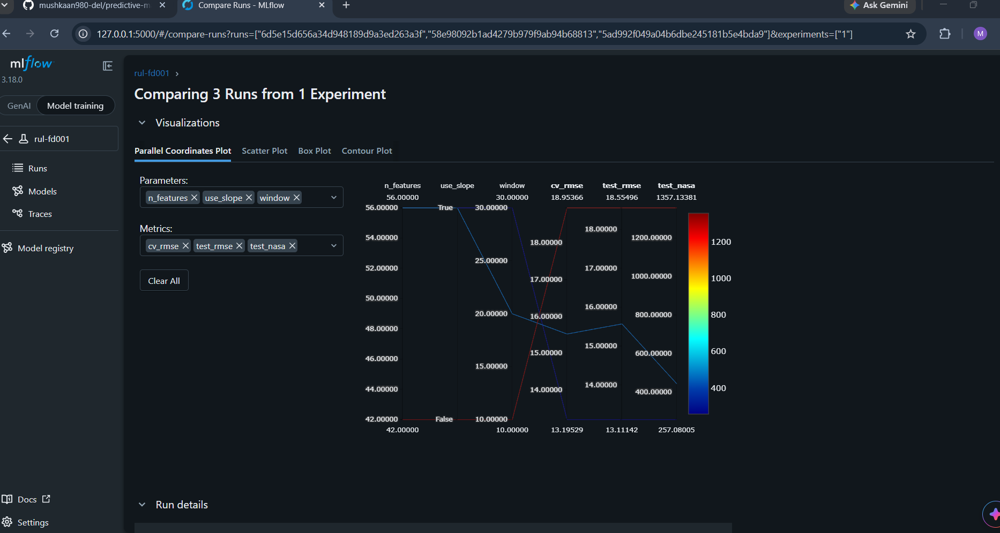
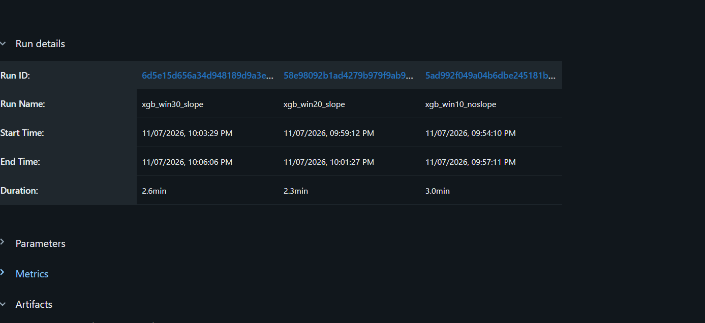

# Predictive Maintenance: RUL Prediction on NASA C-MAPSS

Predicts the remaining useful life (RUL) of turbofan engines from sensor data. The goal is an end-to-end system: a trained model, an API, and a dashboard, with experiments tracked in MLflow.

## Status
- Done: exploratory analysis, RUL labels, XGBoost baseline, ablation study, MLflow tracking
- In progress: sequence models (GRU/LSTM) in PyTorch
- Planned: FastAPI service, React dashboard, alerts

## Dataset
NASA C-MAPSS turbofan engine degradation simulation (FD001-FD004), from the NASA Ames Prognostics Data Repository (Saxena & Goebel), obtained via Kaggle. Place the files in `data/raw/`. The data is not included in this repo.

Current experiments use FD001 (100 training engines, 100 test engines, one operating condition, one fault mode).

## Method
- **Label:** RUL = last cycle of the engine minus the current cycle, capped at 125.
- **Sensors:** 14 of 21 kept; sensors with standard deviation below 0.01 were dropped as constant.
- **Features:** rolling mean, standard deviation and slope of each sensor over the last N cycles (backward-looking only, so no future information leaks).
- **Validation:** 5-fold cross-validation grouped by engine, so no engine appears in both train and validation.
- **Test evaluation:** the last observed cycle of each test engine, against the true RUL from `RUL_FD001.txt` (also capped at 125).
- **Metrics:** RMSE and the NASA asymmetric score (late predictions are penalised more). Lower is better for both.
- Configurations are chosen by cross-validation RMSE, not by test score.

## Results so far (FD001)

| Model | Window | Slope | CV RMSE | Test RMSE | NASA score |
|---|---|---|---|---|---|
| Median baseline | n/a | n/a | n/a | 49.20 | n/a |
| XGBoost | 10 | no | 18.95 | 18.55 | 1357 |
| XGBoost | 20 | yes | 15.52 | 15.57 | 443 |
| XGBoost | 30 | yes | 13.20 | 13.11 | XX |

Longer windows help when the slope feature is used. Window 30 is the longest that fits every test engine (the shortest has 31 observed cycles).

## Project structure
```
predictive-maintenance/
├── data/raw/          # C-MAPSS files (not tracked)
├── ml/
│   └── common.py      # data loading, features, metrics
├── notebooks/
│   ├── 01_eda.ipynb          # exploration
│   ├── 02_labels.ipynb       # RUL labels, sensor selection
│   ├── 03_baseline.ipynb     # XGBoost baseline
│   ├── 04_ablation.ipynb     # window size and slope study
│   └── 05_mlflow_xgb.ipynb   # tracked runs
├── api/               # planned: FastAPI service
├── client/            # planned: React dashboard
└── requirements.txt
```

## Setup (Windows)
```
python -m venv .venv
.venv\Scripts\activate
pip install -r requirements.txt
```
Then put the C-MAPSS files in `data/raw/` and open the notebooks in order.

## Experiment tracking
Runs are logged with MLflow (parameters, metrics, model file, test predictions). To view them:
```
mlflow ui --backend-store-uri sqlite:///mlflow.db
```
Then open http://127.0.0.1:5000. Local tracking files (`mlflow.db`, `mlruns/`, `ml/artifacts/`) are not committed.





## Roadmap
- [x] EDA and RUL labels
- [x] XGBoost baseline and ablation
- [x] MLflow tracking
- [ ] GRU / LSTM / 1D-CNN comparison
- [ ] Uncertainty estimates (prediction intervals)
- [ ] SHAP explanations
- [ ] FastAPI prediction service
- [ ] React dashboard and alerts
- [ ] Tests, Docker, CI
- [ ] Harder datasets (FD002-FD004)